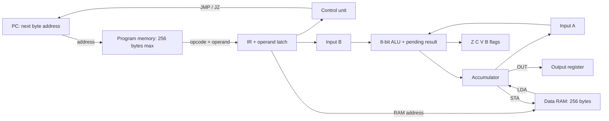

# CPU architecture

CORE8 is a deterministic, Harvard-style educational machine implemented twice: portable C++ on ESP32 and TypeScript in the browser. Firmware has one CPU instance. Keypad and remote commands are dispatched serially by its Arduino loop. Demo mode uses the TypeScript instance. The frontend never advances a local simulator to invent real-hardware telemetry.

Registers ACC, A, B, IR, operand and OUTPUT are bytes. PC allows values 0–256 so falling off a full program is detected, rather than silently wrapping. The address bus selects program/RAM cells; the data bus carries bytes. The JSON transfer representation also permits a 256 end sentinel for control signals. Control paths select operations, coordinate branches and prepare register transfers.

## Four real execution states

| Stage | Observable behavior |
| --- | --- |
| Fetch | PC selects an even byte address; IR and operand latch receive two bytes; PC += 2 |
| Decode | Control Unit checks encoding, selector and branch target; rejects malformed instructions |
| Execute | ALU input latches capture data and compute pending result/flags; LDA samples RAM; branches decide their destination |
| Write-back | Commit ACC, flags, memory, output or branch PC; HLT enters halted state; increment completed-instruction count |

Ready precedes the first Fetch. A trace is emitted for every performed stage or fault. Successful instructions always have four stages, even when Write-back does not change a register. `alu` telemetry exposes the actual pending result and proposed flags at Execute; architectural ACC/flags change only at Write-back.

## Snapshots, animation and replay

Each event includes before/current snapshots, transfers, memory access, ALU details and explanation. Animation uses this event's actual endpoints and value, not inferred decorative activity. Changed registers compare the two snapshots. Paused views remain readable after the one-shot packet animation completes. Reduced-motion preference disables movement while keeping highlights and values.

Frontend state separates the latest CPU snapshot from the selected history cursor. Previous, Replay and history inspection change only the cursor and local playback. They never undo the hardware CPU or send an implicit pause. Explicit Pause sends a hardware command. Recorded playback stops at the latest snapshot and does not silently execute a new instruction. Return to latest follows live events again.

The dashboard retains the latest 512 stage snapshots and can export them as JSON. Earlier stages are discarded explicitly; the latest CPU state stays available. Firmware does not retain an unbounded execution log.

## Scheduling and resource use

- A stage normally occurs every `700 / speed` ms, with speed 0.25, 0.5, 1, 2 or 4. At 0.25×, a stage takes 2.8 seconds.
- No application `delay()` loop blocks CPU playback, Wi-Fi connection or numeric entry. OLED transfers and network library calls are synchronous bounded library operations; measure their real timing on the bench.
- One 1 KB full-buffer OLED is refreshed every 80 ms in rotation (approximately one full three-display refresh per 240 ms). Each reads the same engine state. At fast speed a physical display can skip an intermediate stage; telemetry retains every emitted stage while connected. Use 0.25×/0.5× to demonstrate every stage physically.
- Heartbeat snapshots are sent every two seconds, plus execution/command events. The frontend marks stale telemetry offline after six seconds and reconnects. Duplicate heartbeat sequence numbers update current status without adding history.
- Program and RAM arrays are fixed at 256 bytes. At most eight transfers are retained per event. JSON documents reuse an outer buffer; ArduinoJson and network libraries still allocate dynamically. Monitor free heap through `/api/health` during prolonged hardware runs.
- The CPU is still operational with no SSID or unavailable Wi-Fi. Wi-Fi retries are scheduled at 15-second intervals. Local keys and dashboard requests execute in the same loop, avoiding concurrent CPU mutation.

See INSTRUCTION_SET.md for exact flag behavior and docs/PROTOCOL.md for the wire format.
